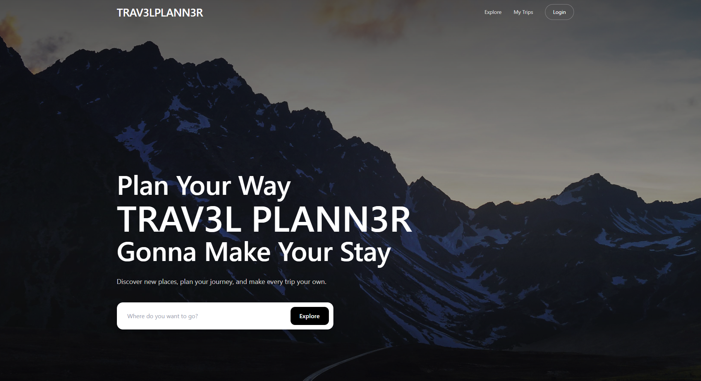
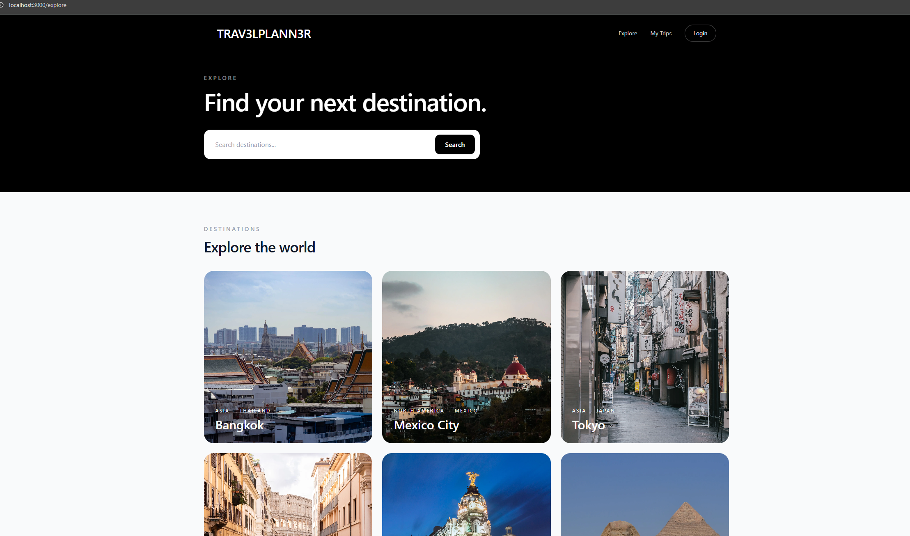
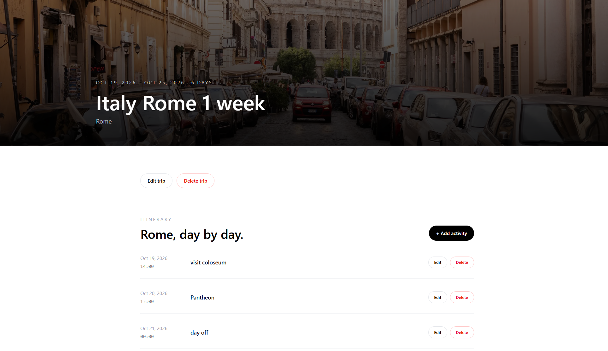

# TRAV3LPLANN3R

Full-stack travel planning web app.

## Tech Stack

- **Backend:** NestJS, Prisma, PostgreSQL
- **Frontend:** Next.js, React, TypeScript
- **Styling:** Tailwind CSS
- **Infrastructure:** Docker

## Features

- User registration and authentication
- JWT-based authentication
- Travel trip creation and management
- Trip editing and deletion
- Destination exploration
- Trip itinerary management
- Activity creation, editing and deletion
- Trip and activity date validation
- User-specific trips and activities

## Getting Started

1. Start the database

docker compose up -d

2. Start backend

cd backend

npm install

npx prisma migrate dev

npm run start:dev

3. Start frontend

cd frontend

npm install

npm run dev

4. Database reset

cd backend

npx prisma migrate reset

